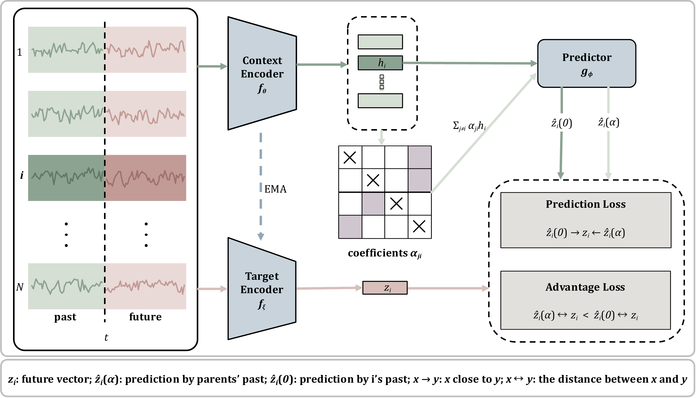
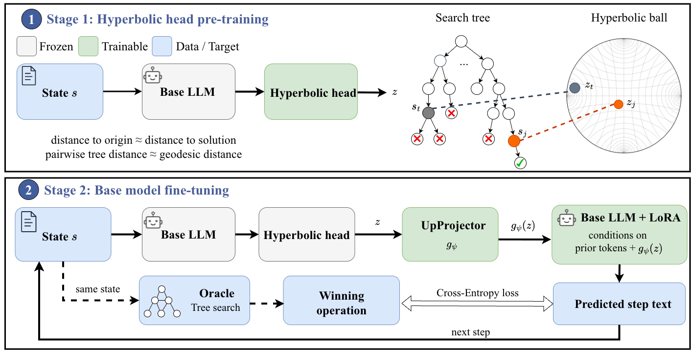
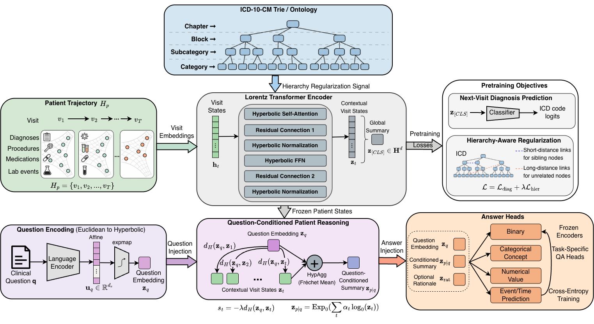
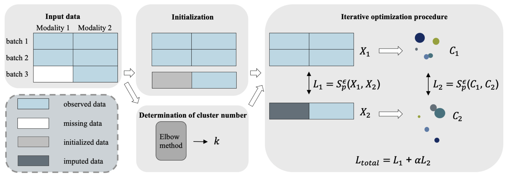

I am a second year Ph.D. student in Computer Science at Stony Brook University, advised by [Tengfei Ma](https://sbu-ma.github.io/). Before starting my Ph.D., I received my B.S. in Mathematics from [Southern University of Science and Technology](https://www.sustech.edu.cn/en/) in 2024.

My research interests lie in machine learning, natural language processing (NLP) and time series foundation models (TSFMs). Currently, I'm working on LLM agentic memory systems and agentic system for TSFMs.

Research
======

  
  

    <strong>Multivariate Time Series Root Cause Analysis via Granger Causal Discovery in Latent Space</strong> 
    <em><u>Yuyu Liu</u>, Xin Wang, Chandra Reddy, Wesley M. Gifford, Tengfei Ma</em>  
    Preprint 
  

  
  

    <strong>HyperGuide: Hyperbolic Guidance for Efficient Multi-Step Reasoning in Large Language Models</strong> 
    <em><u>Yuyu Liu</u>, Haotian Xu, Yanan He, Sarang Rajendra Patil, Mengjia Xu, Tengfei Ma</em> 
    Preprint 
    [<a href="https://github.com/yuyuliu11037/HyperGuide">Code</a>] [<a href="https://arxiv.org/abs/2605.24140">arXiv</a>] 
  

  
  

    <strong>	HypEHR: Hyperbolic Modeling of Electronic Health Records for Efficient Question Answering </strong> 
    <em><u>Yuyu Liu</u>, Sarang Rajendra Patil, Mengjia Xu, Tengfei Ma</em> 
    Findings of ACL 2026 
    [<a href="#">Paper</a>] [<a href="https://github.com/yuyuliu11037/HypEHR">Code</a>] [<a href="https://arxiv.org/abs/2604.21027">arXiv</a>] 
  

  
  

    <strong>Efficient Imputation for Patch-based Missing Single-cell Data via Cluster-regularized Optimal Transport</strong> 
    <em><u>Yuyu Liu</u>, Jiannan Yang, Ziyang Yu, Weishen Pan, Fei Wang, Tengfei Ma</em> 
    ACM BCB 2026 
    [<a href="#">Paper</a>] [<a href="https://github.com/yuyuliu11037/CROT">Code</a>] [<a href="https://arxiv.org/abs/2601.14653">arXiv</a>] 
  

A full list is available on my [Google Scholar](https://scholar.google.com/citations?user=cuL8QqUAAAAJ) profile.

News
======
- **10/2026**: Gave a talk on hyperbolic modeling of EHR and language for efficient reasoning at SIAM NNP 2026 (Rutgers University).

- **7/2026**: Attended ACL 2026 in San Diego and presented our poster on [HypEHR](https://arxiv.org/abs/2604.21027).
- **5/2026**: One paper about single data imputation is accepted by ACM BCB 2026.
- **4/2026**: One paper about hyperbolic EHR modeling for EHR-QA is accepted by ACL2026 (Findings).
- **8/2025**: Started Ph.D.

Contact
======
Feel free to reach out at **yuyu.liu@stonybrook.edu**. You can also find me on [GitHub](https://github.com/yuyuliu11037) or [LinkedIn](https://www.linkedin.com/in/yuyu-liu-b9b476247/).
